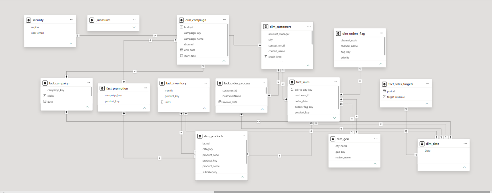

# Enterprise Power BI Data Model Architecture

A star-schema & snowflake data model designed in Power BI to support enterprise-level sales, marketing campaign performance, inventory management, order processing, and target tracking analytics.

---

## 📐 Data Model Diagram

---

## 🏗️ Architecture & Model Overview

The model follows standard dimensional modeling practices using **Fact Tables** for transactional/event data and **Dimension Tables** for context attributes, filtering, and slicing.

### 🌟 Fact Tables
* **`fact_sales`**: Core sales transactions containing key attributes like `bill_to_city_key`, `customer_id`, `order_date`, `orders_flag_key`, and `product_key`.
* **`fact_campaign`**: Tracks marketing campaign performance data (e.g., `clicks`, `date`, `campaign_key`).
* **`fact_promotion`**: Links marketing campaigns to specific products (`campaign_key`, `product_key`).
* **`fact_inventory`**: Tracks product stock levels by time period (`month`, `product_key`, `units`).
* **`fact_order_process`**: Details order fulfillment cycles (`customer_id`, `CustomerName`, `Invoice_date`).
* **`fact_sales_targets`**: Contains target revenue metrics mapped across time periods (`period`, `target_revenue`).

---

### 🔍 Dimension Tables
* **`dim_customers`**: Customer demographics and management data (`account_manager`, `city`, `contact_email`, `contact_name`, `credit_limit`).
* **`dim_products`**: Comprehensive product hierarchy (`brand`, `category`, `product_code`, `product_key`, `product_name`, `subcategory`).
* **`dim_campaign`**: Campaign meta-data (`budget`, `campaign_key`, `campaign_name`, `channel`, `start_date`, `end_date`).
* **`dim_geo`**: Geographic attributes (`city_name`, `geo_key`, `region_name`).
* **`dim_date`**: Central date table enabling time intelligence across all fact entities.
* **`dim_orders_flag`**: Order status, priorities, and channel classifications (`channel_code`, `channel_name`, `flag_key`, `priority`).
* **`security`**: Row-Level Security (RLS) mapping table (`region`, `user_email`).
* **`measures`**: Dedicated measure group/folder containing DAX calculations.

---

## 🔗 Relationships & Data Flow

* **1-to-Many ($1 : \infty$):** Primary relationship type connecting dimensions (1) to fact tables ($\infty$), enabling single-directional filter propagation.
* **Shared Dimensions:** `dim_date`, `dim_products`, and `dim_geo` act as conformable dimensions across multiple fact tables for cross-functional analysis (e.g., comparing actual sales vs. target revenue vs. inventory levels).
* **Security Constraints:** The `security` dimension maps `user_email` to `region` for dynamic Row-Level Security (RLS).

---

## 🛠️ Key Technical Features

* **Star & Snowflake Hybrid Schema:** Optimized for analytical query speed, report responsiveness, and scalar DAX efficiency.
* **Time Intelligence Ready:** Central `dim_date` entity joined across sales, marketing, and targets.
* **Dedicated Measure Table:** Keeps DAX metrics organized and isolated from raw data tables.
